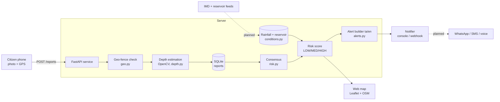
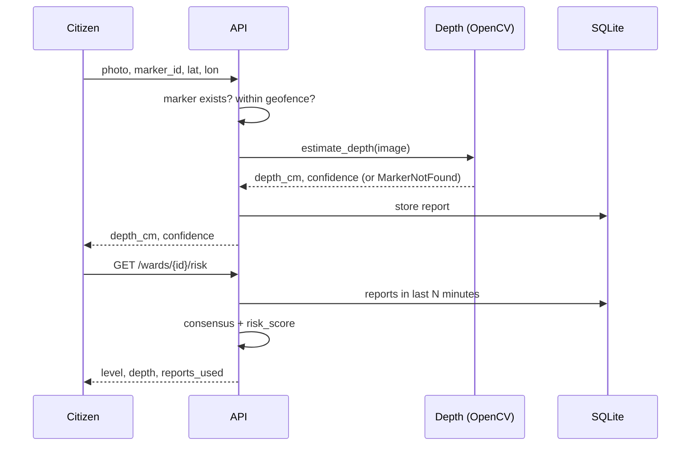
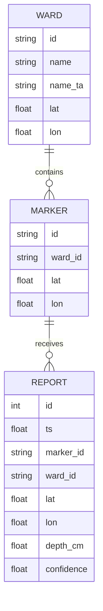

# Neer Kaaval – Technical Design Document

## 1. Goals and scope
Give residents, ambulances and delivery riders **street-level** flood information in **Tamil**, without
installing sensors. The prototype implements the full pipeline from photo to alert; items marked
*planned* are not built.

## 2. System architecture

## 3. Report flow

## 4. Depth estimation (`depth.py`)
- Marker: 10 square bands × 10 cm, alternating red/blue, red at top, ground at the bottom.
- Steps: HSV colour masks → largest connected pattern → per-row dominant colour → run-lengths (tiny gaps bridged)
  → `band_px` = median full-band height → visible bands = (k−1) + fraction of last band →
  `depth = height − visible × band_cm`.
- Confidence falls with inconsistent band heights, a single visible band, or a pattern touching the image top.
- Fully hidden marker → `MarkerNotFound` (rejected, never guessed).

## 5. Fusion and risk (`risk.py`)
- **Consensus:** keep reports with confidence ≥ 0.5, take the median, drop values further than `max(10, 3·MAD)` cm from it.
  Fewer than 2 usable reports sets `low_confidence`.
- **Score:** 0.60·depth/50 cm + 0.25·rainfall/50 mm + 0.15·(reservoir% − 70)/30, each capped to [0, 1]; weights are
  renormalised if no depth report exists. LOW < 0.33 ≤ MEDIUM < 0.60 ≤ HIGH.
- **Override:** measured depth ≥ 50 cm → HIGH; ≥ 30 cm → at least MEDIUM. Constants are heuristics to be calibrated.

## 6. Data model

Wards and markers are JSON files; reports are in SQLite.

## 7. API
| Method | Path | Purpose |
|---|---|---|
| POST | `/reports` | form: `marker_id`, `lat`, `lon`, `image` → depth |
| GET | `/wards` | all wards with risk |
| GET | `/wards/{id}/risk` | one ward's risk details |
| GET | `/alerts/{id}?lang=ta\|en` | alert text |
| POST | `/alerts/{id}/send` | send alert via configured notifier |
| GET | `/health`, `/` | health check, map UI |

## 8. Abuse and privacy controls
Implemented: GPS geo-fence, multi-report consensus with outlier rejection, confidence threshold.
Privacy by design: only depth, GPS and time are stored, not the photo.
*Planned:* authentication, rate limiting, EXIF/time checks, cropping to the marker before upload.

## 9. Extension points
`FileConditionsProvider` → live IMD/reservoir provider · `ConsoleNotifier`/`WebhookNotifier` → WhatsApp/SMS gateway ·
`estimate_depth` → YOLOv8 segmentation front-end · alert templates → Tamil TTS.

## 10. Testing
`pytest` suite: depth accuracy on synthetic images, consensus and risk rules, API validation, Tamil alert text.
